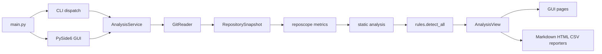

# Architecture

RepoScope is a local-first pipeline with one application entry point.

- `core.git_reader` validates Git paths and reads commits, files, branches, and tags.
- `core.models` contains immutable repository input models.
- `core.services` coordinates configuration, analysis, progress, errors, and batch execution.
- `reposcope.metrics` computes activity, author, file, and compliance metrics.
- `reposcope.static_analysis` scans code quality, dependencies, ownership, secrets, and dangerous calls.
- `reposcope.rules` turns metrics into explainable warnings.
- `gui.contract` adapts analysis results to stable GUI view models.
- `gui` contains pages, widgets, workers, charts, dialogs, and the dark theme.
- `core.reporters` renders the same `AnalysisView` into Markdown, HTML, and CSV.

`main.py` dispatches `analyze`, `check`, `export`, and `batch` to the CLI; all other arguments launch the GUI.
